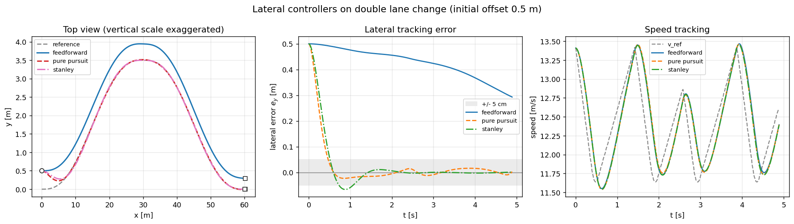

# ad-control

[](https://github.com/fsuyang0107-dev/ad-control/actions/workflows/ci.yml)

自动驾驶**横纵向控制算法**仿真平台。从零实现车辆运动学模型、RK4 积分器、四种标准参考轨迹、
三种横向控制器与纵向 PI 控制，用 **127 个单元测试**保证每个数字可复现。



> 双移线工况，初始横向偏差 0.5 m。**纯前馈（蓝）全程无法消除偏差**；Pure Pursuit（橙）与 Stanley（粉）在 1 s 内收敛到参考线。

---

## 核心结果

### 1. 横向控制

双移线 60 m、初始横向偏差 0.5 m、曲率限速（横向加速度上限 3 m/s²）：

| 控制器 | RMSE (m) | 稳态误差 (m) | 调节时间 (s) | 最大转角 (°) |
|---|---|---|---|---|
| 纯前馈（基线） | 0.4309 | 0.3742 | 未收敛 | 3.42 |
| **Pure Pursuit** | **0.0979** | 0.0163 | **0.46** | 14.39 |
| **Stanley** | 0.1087 | **0.0024** | 1.06 | 8.48 |

稳态误差 **0.374 m → 0.0024 m（约 156 倍）**。

### 2. 纵向控制

| 指标 | 值 |
|---|---|
| 速度阶跃稳态误差（15→20 m/s） | **0.013 m/s** |
| 超调 | **0.3 %** |
| 执行器一阶滞后（1τ 后达到） | **63.2 %**（理论值 1−e⁻¹） |
| 变速度剖面下 RMSE | 0.351 m/s |

### 3. 数值精度

| 积分方法 | 10 s 圆周运动位置误差 |
|---|---|
| 显式欧拉 | 1.86 × 10⁻² m |
| **RK4** | **6.6 × 10⁻¹⁰ m** |

基准是圆周运动的**解析解**，不是两种方法的互相比较。

---

## 架构

```
include/adc/                     接口层（只声明）
├── types.hpp                    数据结构 / 枚举 / 控制器参数
├── integrator.hpp               通用 RK4 积分器（header-only）
├── vehicle_model.hpp            运动学 + 纵向推进
├── trajectory.hpp               4 种轨迹生成 + 曲率限速剖面
├── metrics.hpp                  指标计算 / CSV 输出 / 角度归一化
└── sim_loop.hpp                 最近点查找、3 个横向控制器、纵向 PI、主循环
        │
src/  ──┤  实现层
test/ ──┘  验证层（127 个用例）

构建目标：
    adc_core（静态库） ──┬──> adc_sim（命令行程序）
                        └──> adc_test（测试程序）
```

**单个仿真步的数据流：**

```
① FindNearest     找最近参考点
② 误差            e_y = (车 − rp)·n ，e_yaw ，e_v
③ 横向控制        δ = f(κ_ref, e_y, e_yaw)        → ControlCmd.steer
④ 纵向前馈        a_ff = v · dv/ds
⑤ 纵向 PI         a = a_ff + kp·e_v + ki·∫e_v     → ControlCmd.accel
⑥ 记录            SimRecord{t, state, cmd, errors, ref}
⑦ 推进            StepLongitudinal（更新 a、v）→ StepKinematic（更新 x、y、ψ）
```

---

## 快速开始

```bash
# 依赖（Ubuntu 22.04）
sudo apt install -y build-essential cmake ninja-build git libgtest-dev

# 构建与测试
cmake -S . -B build -G Ninja
cmake --build build
ctest --test-dir build

# 三种控制器对比
./build/adc_sim --scenario dlc --init-y 0.5 --alat 3.0 --compare

# 导出 CSV 并画图
./build/adc_sim --scenario dlc --ctrl stanley --init-y 0.5 --alat 3.0 --csv results/dlc.csv
pip install --user matplotlib
python3 python/plot.py --out docs/figures/out.png --labels stanley results/dlc.csv
```

### 命令行参数

| 参数 | 说明 | 默认 |
|---|---|---|
| `--scenario` | `straight` / `arc` / `dlc` / `sine` | `dlc` |
| `--ctrl` | `ff` / `pp` / `stanley` | `pp` |
| `--compare` | 依次跑三种控制器并输出对比表 | — |
| `--dt` | 仿真步长 [s] | `0.01` |
| `--v` | 参考速度 [m/s] | `15` |
| `--init-y` | 初始横向偏差 [m] | `0` |
| `--init-yaw` | 初始航向偏差 [rad] | `0` |
| `--alat` | 启用曲率限速，横向加速度上限 [m/s²] | `0`（关闭） |
| `--csv` | CSV 输出路径 | — |

---

## 项目结构

```
.
├── CMakeLists.txt
├── include/adc/          # 接口
├── src/                  # 实现
│   └── main.cpp          # 命令行入口
├── test/                 # 127 个 GTest 用例
├── python/plot.py        # CSV → 图
├── docs/figures/         # README 用图
└── results/              # CSV 输出（git 忽略）
```

---

## 实现要点

以下几处是调试中发现并修正的设计决定，不是照抄公式：

| # | 决定 | 原因 |
|---|---|---|
| 1 | **RK4 用解析解验证** | 只比较"RK4 vs 欧拉"无法证明谁对；圆周运动有闭式解，才能给出绝对误差 |
| 2 | **双移线用两段五次多项式拼接** | 6 个边界条件（位置/一阶/二阶导 × 两端）恰好定 6 个系数；拼接处导数全为 0，天然光滑 |
| 3 | **横向误差用参考点法向投影** | 欧氏距离无符号，控制器无法判断该往哪打；投影还剔除了纵向分量 |
| 4 | **执行器滞后用解析解** | 欧拉法在 `dt > 2τ` 时发散；`a += (a_cmd−a)·(1−e^(−dt/τ))` 对任意步长稳定 |
| 5 | **纵向必须加前馈** | 纯 PI 对变化的速度参考有结构性滞后：`rmse_v` 1.61 → **0.35 m/s** |
| 6 | **速度剖面要双向传播** | 只做减速传播时，剖面要求 7.5 m/s² 的加速度而车辆只有 3 —— 控制器再调也追不上 |
| 7 | **jerk 用实际加速度计算** | 用指令加速度会得到 400 m/s³ 的假值（指令在 t=0 阶跃），实际值约 40 |
| 8 | **抗积分饱和用条件积分** | 简单限幅不能根除超调；饱和且误差加剧饱和时冻结积分 |

---

## 测试

**127 个用例，全部通过，耗时 0.4 s。**

| 文件 | 用例 | 关注点 |
|---|---|---|
| `test_types.cpp` | 16 | 数据不变量（轴距自洽、物理量符号、默认值） |
| `test_vehicle_model.cpp` | 11 | 与圆周解析解对比、RK4 vs 欧拉精度阶 |
| `test_trajectory.cpp` | 26 | 曲率解析校验、端点条件、采样均匀性 |
| `test_metrics.cpp` | 15 | RMSE 不抵消、角度归一化、CSV 格式 |
| `test_sim_loop.cpp` | 16 | 最近点、符号约定、记录一致性 |
| `test_ctrl.cpp` | 19 | 控制律符号、闭环收敛、控制器对比 |
| `test_longitudinal.cpp` | 24 | 执行器 τ、抗饱和、剖面可行性、速度跟踪 |

代码规模：接口 304 行 / 实现 720 行 / **测试 1576 行**（测试:实现 ≈ 2.2:1）。

---

## 已知限制

| 限制 | 说明 |
|---|---|
| **运动学模型（无侧滑）** | 假设车轮无侧偏，高速大侧向加速度时精度不足 |
| **无轮胎动力学** | 未建模侧偏刚度、附着极限；`Cf/Cr` 字段已预留但未使用 |
| **纵向模型简化** | 忽略滚动阻力、空气阻力、坡度 |
| **jerk 未约束** | 实测约 40 m/s³，舒适性上限约 3；缺少 jerk 限幅 |
| **全信息跟踪** | 使用整条参考轨迹，而非局部地图（真实系统只给前方数十米） |
| **无规划层** | 参考轨迹由人工参数给定，不含选线、避障、交规 |

---

## 路线图

- [x] 车辆运动学模型 + RK4 积分器
- [x] 四种参考轨迹（直线 / 圆弧 / 双移线 / 正弦）
- [x] 横向控制器：前馈 / Pure Pursuit / Stanley
- [x] 纵向控制：PI + 前馈 + 执行器一阶滞后
- [x] 曲率限速 + 双向可行性速度剖面
- [x] CSV 数据导出 + Python 绘图
- [ ] 二自由度动力学模型（侧偏、轮胎）
- [ ] LQR 横向控制
- [ ] MPC（带约束，OSQP 求解）
- [ ] EKF 状态与参数估计
- [ ] jerk 限幅

---

## 环境

Ubuntu 22.04 · g++ 11.4 · CMake 3.22 · Ninja · GoogleTest 1.11 · Python 3.10 + matplotlib

本项目为个人学习项目，用于验证控制算法的可实现性与可测量性。
