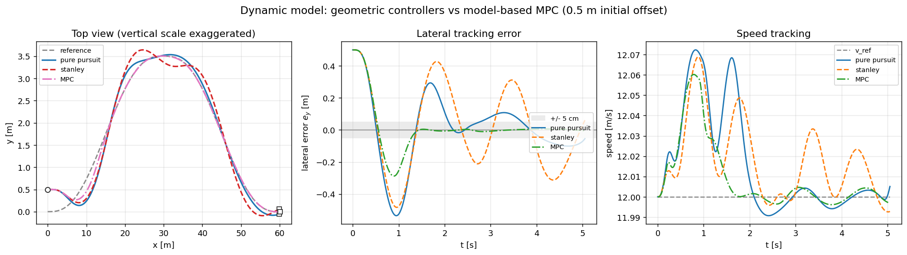

# ad-control

[](https://github.com/fsuyang0107-dev/ad-control/actions/workflows/ci.yml)

自动驾驶**横纵向控制算法**仿真平台。从零实现车辆运动学与二自由度动力学模型、RK4 积分器、
四种参考轨迹、三种几何控制器与**线性 MPC（含约束 QP 求解）**，用 **150 个单元测试**保证每个数字可复现。



> 动力学模型、双移线、初始横向偏差 0.5 m。Stanley（橙）全程振荡；**MPC（绿）在 1.3 s 内收敛并稳定在 ±5 cm 内**。

---

## 核心结果

### 1. 横向控制：几何方法 vs 基于模型（动力学模型）

双移线 60 m、初始横向偏差 0.5 m、`v = 12 m/s`：

| 控制器 | RMSE (m) | 稳态误差 (m) | 类型 |
|---|---|---|---|
| 纯前馈 | 0.447 | 0.803 | 无反馈 |
| Pure Pursuit | 0.222 | 0.101 | 几何，无模型 |
| Stanley | 0.272 | 0.313 | 几何 + 曲率前馈 |
| **线性 MPC** | **0.149** | **0.0066** | **基于模型 + 约束 QP** |

稳态误差 **0.313 m → 0.0066 m（47 倍）**，RMSE 降低 45%。

### 2. 但换成运动学对象，结论完全相反

| 控制器 | 运动学稳态误差 | 动力学稳态误差 |
|---|---|---|
| Stanley | **0.0020 m** | 0.313 m |
| MPC | 0.098 m | **0.0066 m** |

**MPC 的内部模型是动力学模型。** 拿它控制运动学对象属于刻意的模型不匹配，所以反而比 Stanley 差 50 倍。

> **控制器与对象模型是否一致，比算法是否先进更决定性能。**

### 3. 为什么几何控制器到不了？结构决定上限

| 手段 | 动力学稳态误差 | 相对 Stanley |
|---|---|---|
| Stanley 默认 | 0.313 m | 1.0× |
| 改前馈（补不足转向） | 0.280 m | 1.1× |
| 重调增益（Stanley 最优） | 0.227 m | 1.4× |
| 重调前视（PP 最优） | 0.101 m | 3.1× |
| **换结构（MPC）** | **0.0066 m** | **47×** |

**改结构、重调参都只能在同一个量级里挪动；只有引入模型才跨了量级。**

原因：从 `δ` 到 `ψ`，运动学对象只有 **1 个积分器**，动力学对象有 **2 个**（`δ → α → F → ṙ → r → ψ`）。
多一个积分器 = 高频段多 90° 相位滞后 = 增益被相位裕度卡死 = **稳态误差有下限**。

### 4. 纵向控制

| 指标 | 值 |
|---|---|
| 速度阶跃稳态误差（15→20 m/s） | **0.013 m/s** |
| 超调 | **0.3 %** |
| 执行器一阶滞后（1τ 后达到） | **63.2 %**（理论值 1−e⁻¹） |
| 变速度剖面下 RMSE | 0.351 m/s |

### 5. 数值精度

| 积分方法 | 10 s 圆周运动位置误差 |
|---|---|
| 显式欧拉 | 1.86 × 10⁻² m |
| **RK4** | **6.6 × 10⁻¹⁰ m** |

基准是圆周运动的**解析解**，不是两种方法的互相比较。

---

## 架构

```
include/adc/                     接口层（只声明）
├── types.hpp                    数据结构 / 枚举 / 控制器与 MPC 参数
├── integrator.hpp               通用 RK4 积分器（header-only）
├── vehicle_model.hpp            运动学 + 二自由度动力学 + 纵向推进
├── trajectory.hpp               4 种轨迹生成 + 曲率限速剖面
├── metrics.hpp                  指标计算 / CSV 输出 / 角度归一化
├── sim_loop.hpp                 最近点、3 个几何控制器、纵向 PI、主循环
└── mpc.hpp                      线性 MPC + QP 求解器（Cholesky / ADMM）
        │
src/  ──┤  实现层
test/ ──┘  验证层（150 个用例）

构建目标：
    adc_core（静态库） ──┬──> adc_sim（命令行程序）
                        └──> adc_test（测试程序）
```

**单个仿真步的数据流：**

```
① FindNearest     找最近参考点 rp
② 误差            e_y、e_yaw、e_v（都相对后轴）
③ 横向控制        FF / PP / Stanley / MPC     → ControlCmd.steer
④ 纵向前馈        a_ff = v_ref · dv_ref/ds
⑤ 纵向 PI         a = a_ff + kp·e_v + ki·∫e_v → ControlCmd.accel
⑥ 记录            SimRecord{t, state, cmd, errors, ref}
⑦ 推进            动力学：6 状态一步 RK4；运动学：纵向 + 位姿分开积分
```

**两个模型都跟踪同一条参考轨迹（后轴口径），控制器仅在被控对象处不同。**

---

## 快速开始

```bash
# 依赖（Ubuntu 22.04）
sudo apt install -y build-essential cmake ninja-build git libgtest-dev

# 构建与测试
cmake -S . -B build -G Ninja
cmake --build build
ctest --test-dir build

# 四种控制器对比（动力学模型）
./build/adc_sim --scenario dlc --model dyn --v 12 --init-y 0.5 --compare

# 单独跑 MPC 并导出 CSV
./build/adc_sim --scenario dlc --ctrl mpc --model dyn --v 12 --init-y 0.5 \
    --csv results/mpc.csv
pip install --user matplotlib
python3 python/plot.py --out docs/figures/out.png --labels MPC results/mpc.csv
```

### 命令行参数

| 参数 | 说明 | 默认 |
|---|---|---|
| `--scenario` | `straight` / `arc` / `dlc` / `sine` | `dlc` |
| `--ctrl` | `ff` / `pp` / `stanley` / `mpc` | `pp` |
| `--model` | `kin`（运动学）/ `dyn`（动力学） | `kin` |
| `--compare` | 依次跑全部控制器并输出对比表 | — |
| `--dt` | 仿真步长 [s] | `0.01` |
| `--v` | 参考速度 [m/s] | `15` |
| `--init-y` | 初始横向偏差 [m] | `0` |
| `--init-yaw` | 初始航向偏差 [rad] | `0` |
| `--alat` | 启用曲率限速，横向加速度上限 [m/s²] | `0`（关闭） |
| `--csv` | CSV 输出路径 | — |

---

## 项目结构

```
.
├── CMakeLists.txt
├── include/adc/          # 接口
├── src/                  # 实现
│   ├── main.cpp          # 命令行入口
│   └── mpc.cpp           # 线性 MPC + QP 求解器
├── test/                 # 150 个 GTest 用例
├── python/plot.py        # CSV → 图
├── docs/figures/         # README 用图
└── results/              # CSV 输出（git 忽略）
```

---

## 实现要点

以下均为调试中发现并修正的设计决定，不是照抄公式：

| # | 决定 | 原因 |
|---|---|---|
| 1 | **RK4 用解析解验证** | 只比较"RK4 vs 欧拉"无法证明谁对；圆周运动有闭式解，才能给出绝对误差 |
| 2 | **双移线用两段五次多项式拼接** | 6 个边界条件恰好定 6 个系数；拼接处导数全为 0，天然光滑 |
| 3 | **横向误差用参考点法向投影** | 欧氏距离无符号，控制器无法判断该往哪打；投影还剔除了纵向分量 |
| 4 | **执行器滞后用解析解** | 欧拉法在 `dt > 2τ` 时发散；`a += (a_cmd−a)(1−e^(−dt/τ))` 对任意步长稳定 |
| 5 | **纵向必须加前馈** | 纯 PI 对变化的速度参考有结构性滞后：`rmse_v` 1.61 → **0.35 m/s** |
| 6 | **速度剖面要双向传播** | 只做减速传播时，剖面要求 7.5 m/s² 而车只有 3——控制器再调也追不上 |
| 7 | **jerk 用实际加速度计算** | 用指令加速度会得到 400 m/s³ 的假值，实际值约 40 |
| 8 | **抗积分饱和用条件积分** | 简单限幅不能根除超调；饱和且误差加剧饱和时冻结积分 |
| 9 | **动力学状态点选后轴** | 参考轨迹是后轴口径；改用重心会凭空引入 `l_r·sinβ ≈ 5 cm` 伪误差 |
| 10 | **零速时侧向力按速度缩放** | 否则 `atan2(·, v_x)` 在 `v_x→0` 处奇异，静止车辆会自转 |
| 11 | **MPC 的 `ė_y` 必须含 `−l_r·r`** | `e_y` 在后轴、`v_y` 在重心，后轴横向速度是 `v_y − l_r·r`；漏掉这一项（≈0.675 m/s）闭环立刻退化 |
| 12 | **MPC 把曲率当已知扰动** | 曲率进 `ė_yaw = r − v·κ` 而非靠反馈追，等价于模型前馈 |

---

## 测试

**150 个用例，全部通过，耗时约 1 s。**

| 文件 | 用例 | 关注点 |
|---|---|---|
| `test_types.cpp` | 16 | 数据不变量（轴距自洽、物理量符号、默认值） |
| `test_vehicle_model.cpp` | 11 | 与圆周解析解对比、RK4 vs 欧拉精度阶 |
| `test_trajectory.cpp` | 26 | 曲率解析校验、端点条件、采样均匀性 |
| `test_metrics.cpp` | 15 | RMSE 不抵消、角度归一化、CSV 格式 |
| `test_sim_loop.cpp` | 16 | 最近点、符号约定、记录一致性 |
| `test_ctrl.cpp` | 19 | 控制律符号、闭环收敛、控制器对比 |
| `test_longitudinal.cpp` | 24 | 执行器 τ、抗饱和、剖面可行性、速度跟踪 |
| `test_dynamic.cpp` | 11 | 不足转向梯度 vs 理论、中性转向退化、附着饱和、零速正则 |
| `test_mpc.cpp` | 12 | 线性化一致性、**后轴参考点回归**、QP 求解器、优于几何控制器 |

代码规模：接口 404 行 / 实现 1173 行 / **测试 2044 行**（测试:实现 ≈ 1.7:1）。

---

## 已知限制

| 限制 | 说明 |
|---|---|
| **线性轮胎** | 只有线性区 + 硬饱和，没有 Fiala/Pacejka 的平滑过渡 |
| **无载荷转移** | `F_z` 用静态值，未考虑纵向/侧向加速度引起的转移 |
| **纵向未显式建模侧向拖拽** | `a_cmd` 定义为净轴向加速度，故 `v̇_x = a_cmd + v_y·r` 自洽；显式建模需给控制器加前馈或改用 MPC |
| **无转向执行器动态** | 转向视为瞬时（加了一阶滞后会使运动学整定的增益失稳，留给 MPC 一起设计） |
| **MPC 只有幅值约束** | 缺转向速率约束，初始大偏差时转向打满并超调 |
| **MPC 模型为动力学** | 因此不适用于低速纯运动学对象（会因模型不匹配退化） |
| **jerk 未约束** | 实测约 40 m/s³，舒适性上限约 3 |
| **无规划层** | 参考轨迹由人工参数给定，不含选线、避障、交规 |

---

## 路线图

- [x] 车辆运动学模型 + RK4 积分器
- [x] 四种参考轨迹（直线 / 圆弧 / 双移线 / 正弦）
- [x] 横向控制器：前馈 / Pure Pursuit / Stanley
- [x] 纵向控制：PI + 前馈 + 执行器一阶滞后
- [x] 曲率限速 + 双向可行性速度剖面
- [x] CSV 导出 + Python 绘图
- [x] 二自由度动力学模型（侧偏、附着饱和、低速正则）
- [x] 线性 MPC（路径相对误差模型 + 约束 QP）
- [ ] 转向速率约束 + `Δδ` 平滑项
- [ ] LQR（作 MPC 无约束情形的对照）
- [ ] EKF 状态与参数估计
- [ ] jerk 限幅

---

## 环境

Ubuntu 22.04 · g++ 11.4 · CMake 3.22 · Ninja · GoogleTest 1.11 · Python 3.10 + matplotlib

本项目为个人学习项目，用于验证控制算法的可实现性与可测量性。
